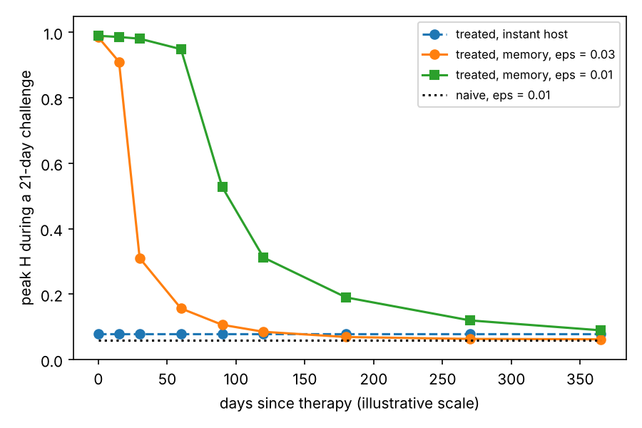

# Periodontal host-memory model

Code, notebooks and exported data for

> Galli C, Colangelo MT, Rossetti S, Meleti M, Calciolari E. **Modeling the persistence of altered host responsiveness after periodontal therapy.** Submitted to the *Journal of Periodontal Research*, 2026.

[](https://doi.org/10.5281/zenodo.23513019)

This repository is the **archived scientific record** of the paper. The interactive teaching site, where the model can be explored in the browser, lives separately at **[periodontal-dynamics-lab](https://github.com/CarloGalliUnipr/periodontal-dynamics-lab)**. Results should be cited from this repository (by DOI and version), not from the interactive site.

Release 1.0.0 accompanied an earlier version of the manuscript. Release 1.1.0 adds the experiments, figure scripts and numbers ledger of the JPR version (see `CHANGELOG.md`).

> **Not a clinical tool.** The model is phenomenological and uncalibrated; its variables are dimensionless and the time mapping (1 unit ≈ 1.7 days) is illustrative. It does not support choosing recall intervals or predicting patient outcomes.

## Contents

| Folder | What it holds |
|---|---|
| `src/periomemory/` | Python package: the final model (H, M, A, D), equilibria and folds, and the paper's protocols (therapy, critical challenge, periodic plaque removal, reduced map, episodic activity) |
| `tests/` | Regression tests: the package reproduces values exported by the notebooks (about 30 s) |
| `notebooks/` | The Google Colab notebooks that ran every experiment, outputs stripped ([index](notebooks/README.md)) |
| `results/` | The exported data of each experiment, as produced by the notebooks ([index](results/README.md)) |
| `scripts/` | The scripts that draw every figure of the paper from the exports, and the numbers ledger ([index](scripts/README.md)) |
| `reference/` | Reference trajectories for checking other implementations, such as the JavaScript engine of the lab |
| `examples/` | A short script: a treated and a naive site rechallenged at increasing times after therapy |

## The model

A single periodontal site with host inflammatory activity *H*, subgingival community activity *M*, adaptive response state *A* and attachment loss *D*, forced by supragingival plaque *u*:

```
dH/dt = -H + F(M + u; θ0·e^(-A))
dM/dt = r·(-M + G(H) + γ·D·(c + (1 - c)·H))
dA/dt = ε·(A*(H) - A),        A*(H) = α·H - β·H²
dD/dt = δ·[H - hD]+ · (1 - D)

F(S; θ) = Sⁿ / (Sⁿ + θⁿ),     G(H) = H^q / (H^q + K^q)
```

The **instant host** sets *A* = *A\**(*H*) at all times. It shares every equilibrium and fold with the memory host, so any difference between the two under the same forcing is an effect of memory. Reference site: n = q = 4, K = 0.9, θ0 = 0.8, r = 1, α = 1. Integration: classical RK4, step 0.1. The extensions of Experiment 17 (resolution rate ρ, pro-resolving adjunct λ, community memory B) are implemented in that notebook and reduce exactly to this model when switched off.

## Quick start

```bash
git clone https://github.com/CarloGalliUnipr/periodontal-host-memory-model.git
cd periodontal-host-memory-model
pip install -e ".[test]"
pytest                       # reproduces exported values
python examples/quickstart.py
```

```python
import numpy as np
import periomemory as pm

p = pm.REFERENCE
print(pm.folds(p))                     # (H_up, u_up, H_down, u_down)
print(pm.stage_boundaries(p))          # D_irr, D_spont under perfect plaque control

m = pm.Model(**p, eps=0.01)            # memory time 1/eps
diseased = pm.tile(pm.eq_state(p, 0.20, "high"), 1)
treated, ok, retained = pm.therapy(m, diseased)   # debridement + ~1 week of plaque control
print(ok, retained)                    # H back to health, ~97% of A retained
```



## Reproducing the paper

**Simulations.** Every experiment was run in a Google Colab notebook in `notebooks/` (Python 3.13; versions in each export's `software_versions.txt`). Each notebook writes its outputs to a folder named `…_EXPORT` and zips it; those zips are in `results/`, unchanged, with checksums in `results/SHA256SUMS.txt`. Experiments 15–17 and 19 install this package from the repository and build on it (Experiment 17 extends the model and first checks that the extension reduces to the package exactly), and each checks itself against values exported by earlier experiments (see `all_checks.csv` in each export). The package in `src/` is a cleaned copy of the model and protocol code of `Experiment_14_Revision`; `tests/` verifies that it returns the same numbers.

To rerun an experiment, open its notebook in Colab (or Jupyter, skipping any Google Drive mount cell) and run all cells. Several notebooks have a `FAST = True` switch for a smoke test.

**Figures.** The figures of the paper are drawn from the exports by the scripts in `scripts/`:

```bash
pip install -e ".[notebooks]"
python -I scripts/prepare_figure_data.py figure_data
python -I scripts/make_figures_JPR.py    figure_data figures_main
python -I scripts/make_figures_JPR_SI.py figure_data figures_si
python -I scripts/make_figure_S22.py     figure_data/E17 figures_s9
```

Each panel is written with its source data. `scripts/numbers_ledger_JPR.csv` traces every value quoted in the main text to the export and file it comes from.

## Citation

Please cite the article and this software (see `CITATION.cff`; GitHub shows a "Cite this repository" button). Each release is archived on Zenodo with its own DOI; the DOI above always resolves to the latest release.

## Licence

Code and notebooks: MIT (see `LICENSE`). Exported data in `results/` and `reference/`: CC BY 4.0 (see `LICENSE-DATA.md`).
